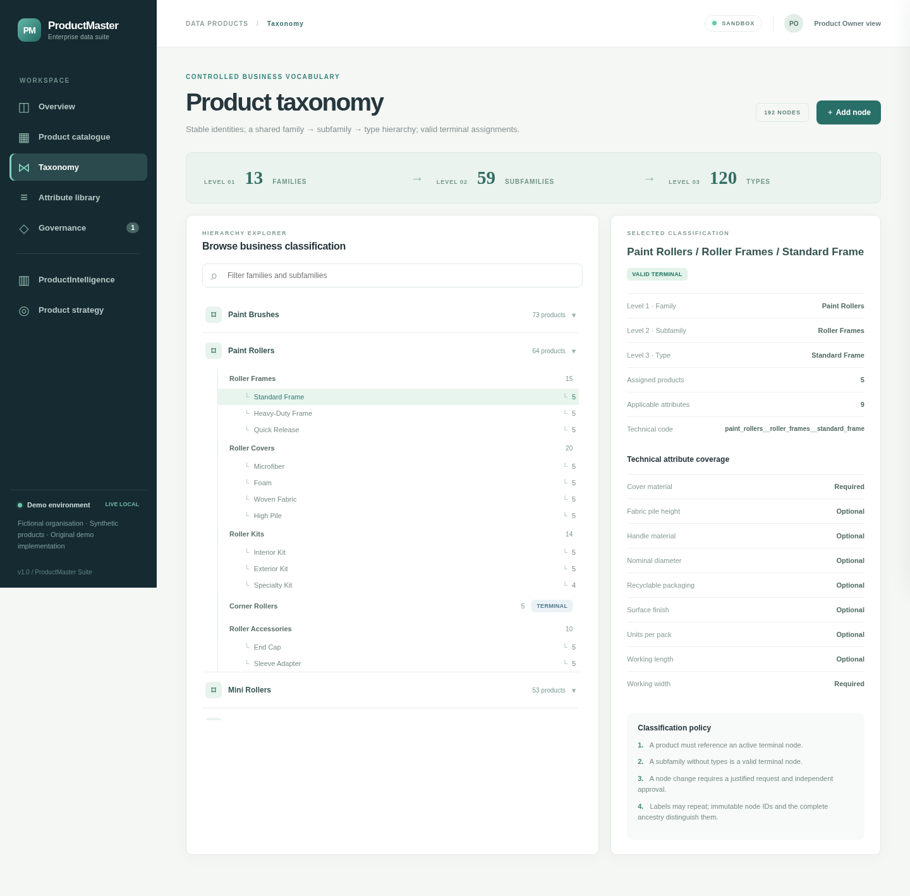
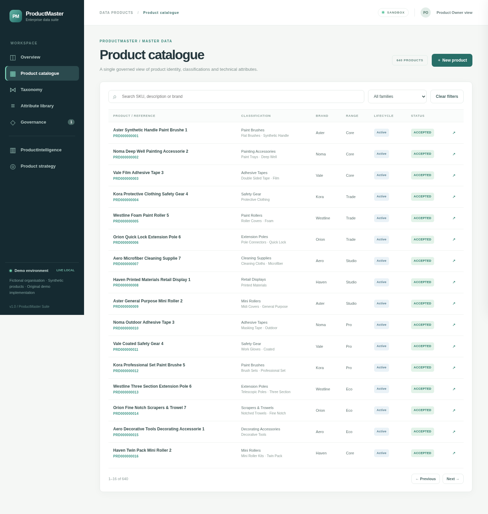
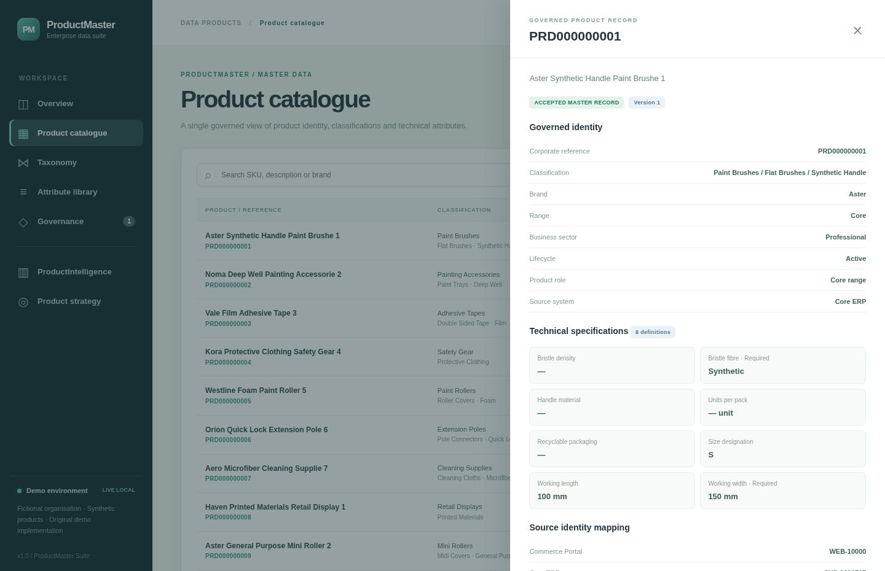
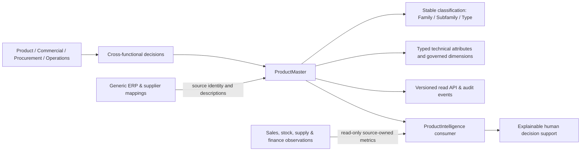

# ProductMaster · Enterprise Product Data

### A governed product catalogue, complete taxonomy, technical specifications and explainable ProductIntelligence.

**Product ownership · Cross-functional alignment · Master data governance · API-first delivery**


> **Independent, synthetic demonstration.** This repository contains original code and a newly authored fictional catalogue. Company identities, real product references, supplier/employee information, original system integrations, internal documentation and proprietary source code are not present. Workshop scenarios, approvals, statistics and measurements are fictional. This is a **feature-complete local demonstration**, not a claim of an enterprise production deployment.

## The product problem

A product can be described differently across Product Management, Commercial, Procurement, Operations, Finance and Data & IT. The same reference appears under competing categories, supplier terminology does not match commercial navigation, and technical characteristics have inconsistent definitions.

ProductMaster addresses the organisational problem **before** the technical one: agree a common product language, define who owns the meaning of each field, publish trusted product identities and govern every significant change. Only then should analytics combine the product context with time-bound operational and financial observations.

## Explore the application

| Product surface | Demonstration |
|---|---|
| **Product catalogue** | 640 fully fictitious, uniquely identified products with descriptive records, category paths, master dimensions, typed attributes and source mappings |
| **Business taxonomy** | **192 nodes:** 13 families, 59 subfamilies, 120 types; stable node IDs; terminal-subfamily handling and complete classification ancestry |
| **Specifications** | 25 definition types, controlled enumerations, units, typed validation, category applicability and requiredness |
| **Governance** | Attributable requests for classification, specifications **and commercial dimensions**; independent approval/rejection, version checks, audit trail |
| **Administration** | Add a product, create an optional attribute definition and extend a safe taxonomy branch, using local demo administration |
| **ProductIntelligence** | Read-only synthetic sales, stock, demand, incoming supply, coverage days, projected shortage and missing-evidence flags |
| **Product leadership** | Vision, stakeholder map, RACI, delivery roadmap, prioritised backlog, decision policy and acceptance criteria |

<div align="center">


</div>
<div align="center">


</div>

[See ProductIntelligence](assets/06-intelligence.png) · [Read the Spanish case study](docs/01-caso-de-estudio-es.md)

## Run locally

**Requirements:** Python 3.11+. No cloud account, corporate system, API key or PostgreSQL server is required.

```bash
# Unzip or clone this repository
cd productmaster-complete

python -m venv .venv
# Windows PowerShell: .venv\Scripts\Activate.ps1
# macOS/Linux: source .venv/bin/activate
python -m pip install -e '.[dev]'

uvicorn app.main:app --reload --host 127.0.0.1 --port 8000
```

Open **http://127.0.0.1:8000** to explore the web application, or **http://127.0.0.1:8000/docs** for the interactive OpenAPI documentation.

**Docker alternative:** `docker compose up --build`, then open the same localhost address. The compose file binds to `127.0.0.1` only and uses a dedicated volume for its synthetic database.

A reproducible demo database is generated on first run in `data/productmaster.sqlite3`. To reset it, stop the app, delete only this local synthetic file and relaunch. The seed uses stable fictitious SKUs and taxonomy IDs, with no external data download.

```bash
python -m pytest -q
```

The project includes **25 automated tests** of classification completeness, attribute validation, creation, approval, rejection, concurrency safeguards, source separation and API availability.

## Architecture and the ProductMaster → ProductIntelligence boundary



The application is an original **modular local demo** using FastAPI + SQLite + HTML/CSS/JavaScript. ProductMaster's product tables are separated from analytical observations, so sales, inventory and finance values are not editable product attributes. A production architecture could replace persistence and identity modules without changing the meaning of the business contracts.

## What makes the taxonomy meaningful?

The database stores **nodes, parents and stable IDs**, not three unrelated string columns. The interface derives `Family → Subfamily → Type` from each product's most specific node. A subfamily **without** type children is a valid terminal classification, whereas a subfamily **with** types requires selection of a type. Repeated display labels are scoped by parent identity, so `Foam` under Mini Covers and `Foam` under Roller Covers are different classifications.

Specifications are metadata-driven: a field such as `working_width` declares a datatype, unit, applicability and whether it is required. It is never inferred from a product description or created as an ungoverned custom column. See [Complete taxonomy and attributes](docs/03-taxonomy-and-attributes.md).

## Decision ownership and the delivery sequence

The case study follows a realistic product-management sequence: discovery → department alignment → taxonomy approval → catalogue → correction workflows → governed APIs → analytical consumption. It gives the Product Owner a defensible set of priorities, trade-offs, definitions of done, outcomes and stakeholder decisions; the fictitious scenarios are clearly distinguished from documented actual outcomes.

- [Cross-functional coordination and RACI](docs/02-cross-functional-delivery.md)
- [Full taxonomy, attribute dictionary and completeness rules](docs/03-taxonomy-and-attributes.md)
- [Approval, audit and metadata governance](docs/04-governance-workflow.md)
- [ProductIntelligence evidence and calculations](docs/05-productintelligence.md)
- [API contracts and design decisions](docs/06-architecture-and-contracts.md)
- [Roadmap, backlog and acceptance criteria](docs/07-roadmap-backlog.md)
- [End-to-end walkthrough](docs/08-demo-walkthrough.md)
- [Technical and confidentiality boundaries](docs/09-disclosure-and-limits.md)
- [Logical data model](docs/10-schema.md)
- [Publish to GitHub](PUBLISHING.md)

## Three things to try

1. Open **Taxonomy**, expand *Paint Rollers → Roller Covers* and inspect a leaf. Note the difference between a path, a label and a stable identity.
2. Open **Product catalogue**, select a product, inspect its technical metadata and choose **Propose governed change**. Return to Governance to review the request as an independent simulated actor.
3. Open **ProductIntelligence** and compare different product evidence states. A projected shortfall can trigger *human review*, never an automatic purchasing, classification or lifecycle change.

## Security and deployment status

**Local single-user demonstration only.** Actor names and simulated reviewer roles are not authentication. There is no production SSO, protected RBAC, secrets infrastructure, concurrency across distributed writers, cross-company tenancy, deployment pipeline, source API integration or formal UAT. The browser and API should remain bound to `127.0.0.1` on your machine.

The features are implemented for an end-to-end *demo*, not represented as a certified corporate solution. The full scope and limitations are recorded in [disclosure and limits](docs/09-disclosure-and-limits.md).

**License:** MIT for the newly authored portfolio code. Data and organizational scenarios are fictitious.
