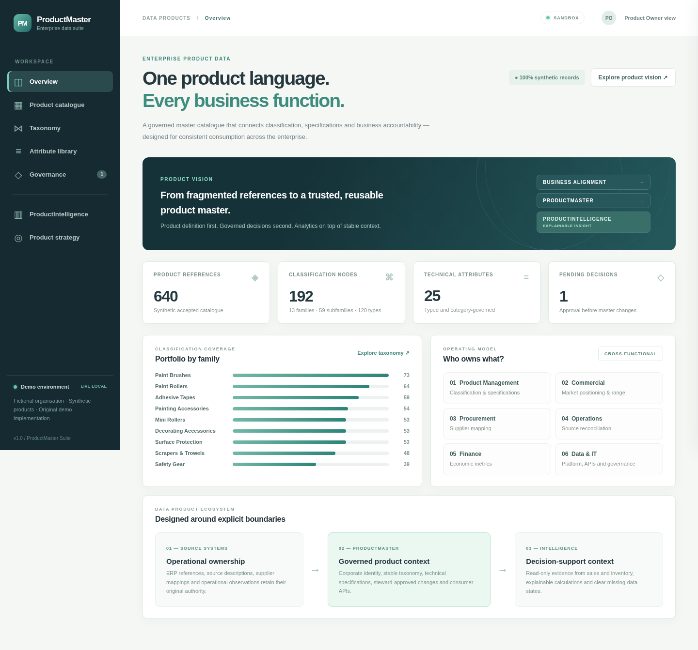
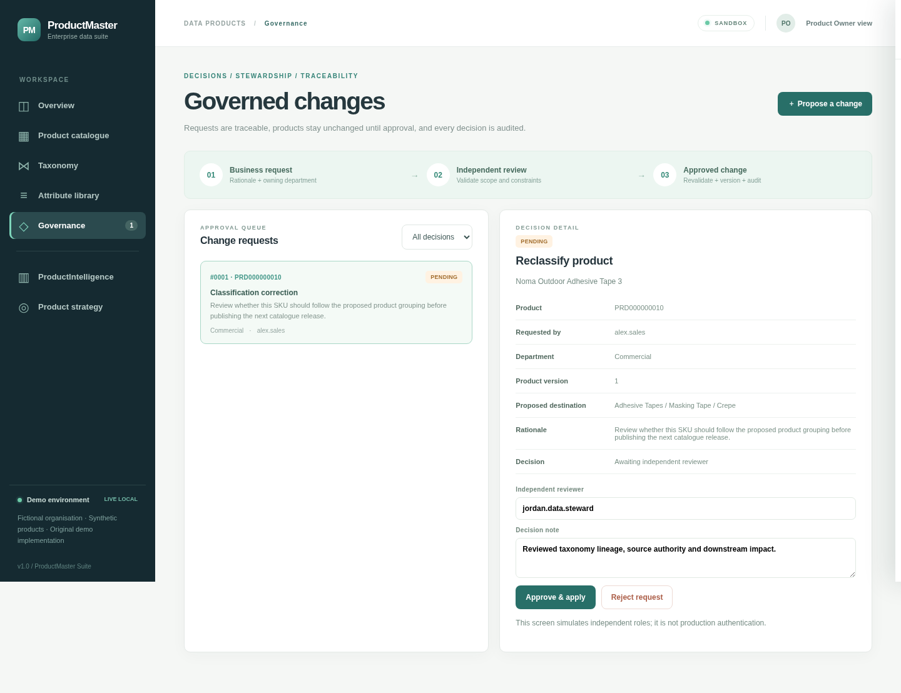
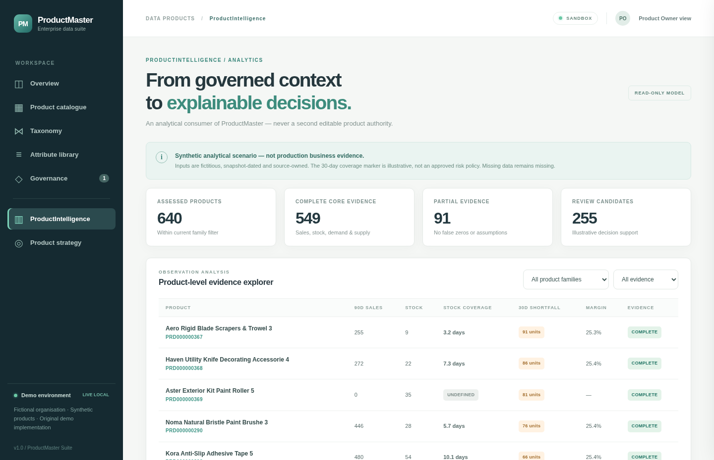

# ProductMaster
**Enterprise product data governance | Cross-functional Product Ownership | ProductIntelligence**

An end-to-end, **synthetic and independent** implementation of a governed product master for a fictional painting and decorating business. It demonstrates how teams move from inconsistent departmental classifications to reusable, trustworthy product data.

## The product challenge

Product Management, Sales, Procurement, Operations and Finance need different views of the same products. Without a shared vocabulary, classifications drift, technical attributes become inconsistent and analysts must repeatedly reconcile conflicting descriptions.

The Product Owner's challenge is to **align the departments before scaling the technology**: agree the taxonomy, define data ownership, prioritise a roadmap, set acceptance criteria and provide dependable contracts for downstream consumers.

## What the demo delivers

| Capability | Implemented example |
| --- | --- |
| **Governed catalogue** | 640 fictional products with stable identities, source mappings, category paths and commercial dimensions |
| **Business taxonomy** | 192 nodes: **13 families, 59 subfamilies and 120 types**; hierarchical identities and terminal-node rules |
| **Technical specifications** | 25 metadata-defined attributes, typed values, units, controlled options, applicability and requiredness |
| **Change governance** | Proposed corrections, independent simulated decisions, optimistic version checks and audit history |
| **Administration** | Product creation, safe taxonomy extension and optional attribute definitions |
| **ProductIntelligence** | Read-only synthetic sales, stock, demand, coverage, incoming supply and projected shortages |
| **Product delivery** | Stakeholder alignment, RACI, roadmap, prioritised backlog, user stories and testable acceptance criteria |

  
  

  
  

## From cross-functional alignment to governed data

1. **Discovery:** identify classification and terminology conflicts across departments.
2. **Shared taxonomy:** agree Family → Subfamily → Type, preserving stable identifiers and valid terminal branches.
3. **Attribute governance:** define data types, units, applicability, source authority and accountable stewards.
4. **Controlled changes:** submit evidence-based corrections and require an independent approval before changing accepted master data.
5. **Reusable product:** expose consistent product identities, hierarchy and specifications through a versioned API.
6. **ProductIntelligence:** combine governed master context with time-dependent source-owned observations for explainable human decision support.

This workflow is simulated in the application and described as a Product Owner case study in [cross-functional delivery](docs/02-cross-functional-delivery.md).

## Architecture

~~~mermaid
flowchart LR
    A[Product / Sales / Procurement / Operations] --> B[Shared definitions and decision ownership]
    B --> C[ProductMaster]
    C --> D[Catalogue, taxonomy and specifications]
    C --> E[Versioned Product API and change audit]
    C --> F[ProductIntelligence]
    G[Read-only sales, stock and demand observations] --> F
    F --> H[Explainable decision support]
~~~

The executable demo uses **Python, FastAPI, SQLite and vanilla JavaScript**. The domain separates permanent master-data authority from operational and financial observations; analytical metrics cannot be edited as product attributes.

## Run locally

Requires **Python 3.11+**. No API keys, enterprise accounts or external databases are needed.

~~~bash
git clone https://github.com/roger-sans/productmaster-enterprise-demo.git
cd productmaster-enterprise-demo

python -m venv .venv
# Windows PowerShell: .venv\Scripts\Activate.ps1
# macOS / Linux: source .venv/bin/activate
python -m pip install -e ".[dev]"

uvicorn app.main:app --reload --host 127.0.0.1 --port 8000
~~~

Open **http://127.0.0.1:8000** for the application and **http://127.0.0.1:8000/docs** for OpenAPI.

Alternatively, run **docker compose up --build** and access the same local address. The SQLite demo database is created on first use; it is excluded from Git.

Run the automated checks:

~~~bash
python -m pytest -q
~~~

The repository contains **25 automated tests** covering classification integrity, data validation, governance decisions, concurrency safeguards and API behaviour. GitHub Actions runs the tests on pushes and pull requests.

## Explore the design decisions

| Area | Documentation |
| --- | --- |
| Business problem and Product Owner role | [Case study (Spanish)](docs/01-caso-de-estudio-es.md) |
| Department alignment and responsibilities | [Stakeholders, decisions and RACI](docs/02-cross-functional-delivery.md) |
| Taxonomy and technical specifications | [Hierarchies, attributes and applicability](docs/03-taxonomy-and-attributes.md) |
| Approval process and accountability | [Governance workflow](docs/04-governance-workflow.md) |
| Explainable analytics | [ProductIntelligence](docs/05-productintelligence.md) |
| Technical design | [Architecture and API contracts](docs/06-architecture-and-contracts.md) · [Data model](docs/10-schema.md) |
| Prioritisation and delivery | [Roadmap and backlog](docs/07-roadmap-backlog.md) · [Backlog CSV](docs/backlog.csv) |
| Demonstration | [Walkthrough](docs/08-demo-walkthrough.md) |

## Scope and limitations

This repository uses **original implementation code, fictional products and simulated organisational decisions**. It is a functional **local portfolio demo**, not an enterprise deployment or a claim of measured business outcomes.

Reviewer names are simulated, **not authenticated user identities**. There is no production SSO, RBAC, ERP integration or security hardening. Keep the application bound to localhost. See [demo boundaries](docs/09-disclosure-and-limits.md) for details.

**License:** MIT.
