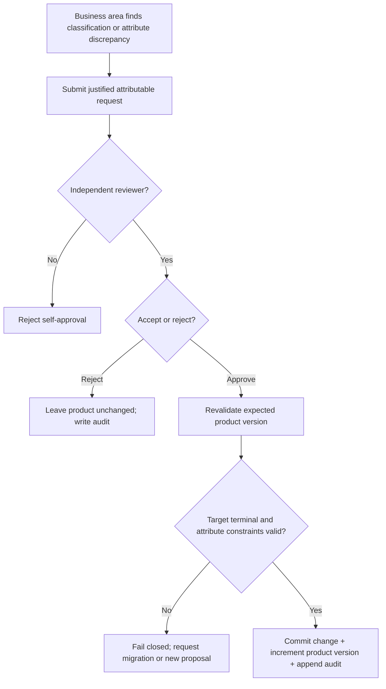

# Governance, change control and data quality

## Four-eyes product correction workflow

## Product identity and provenance

Each accepted product is assigned a unique synthetic business SKU (12 characters) and a classification-node UUID. A product can have multiple independent source mappings, but supplier references do **not** create additional master identities. Historical audit entries record actor, event type, timestamp, request ID and before/after values.

## Critical rules implemented

- A product points to an **active terminal** classification node. Nonterminal family/subfamily placeholders are not silently accepted.
- Subfamilies with no children can be terminal; subfamilies with type children require a terminal type.
- Technical attributes are validated against their metadata definitions and inherited family applicability.
- Enumerated options must match approved vocabularies; numbers and booleans cannot be silently accepted as arbitrary text.
- Required technical attributes must exist for an accepted product.
- The requester cannot approve or reject their own request.
- A product version change between request and approval blocks stale approval.
- Cross-family reclassification that would orphan existing attributes fails closed until a separately governed migration is defined; technical values are not silently discarded.
- Adding a new required definition to a populated, accepted family is blocked pending a backfill and approval plan. An optional definition can be added without invalidating existing master records.
- An accepted product's classification is never modified at submission time.
- Commercial master dimensions (`brand`, `range_name`, `sector`, `lifecycle`, `business_role`) can be changed only through the same independent review flow; source-owned fields remain excluded.
- Economic and operational metrics remain outside product technical attributes.

## Metadata and lifecycle change

The demo includes API endpoints for creating optional attribute definitions and extending safe taxonomy branches. These are simulated **local administration operations**, not a real role-checked governance approval for changing the enterprise dictionary. A production solution must route structural changes through named domain owners and release gates, with explicit migration treatment if a previously terminal subfamily becomes a parent.

## Quality dimensions

| Dimension | Example rule | Implementation |
|---|---|---|
| Identity | One corporate SKU per product | Database uniqueness and length check |
| Classification | Correct ancestry and terminal assignment | Domain invariant and API validation |
| Completeness | Mandatory attributes by applicability | Metadata-driven validation |
| Consistency | Controlled vocabulary, type, units | Attribute type and option checks |
| Traceability | Approved business requests and timestamps | Request and audit records |
| Source authority | External observations never become manual master fields | Separate SQL tables and API contracts |
| Change safety | Stale updates and self-approvals blocked | Expected version and four-eyes review |

**Not implemented as production security:** authentication, user-directory identity, protected roles, per-market access, encryption/key management, and tamper-evident immutable audit storage. All actors are supplied by simulated demo fields.
