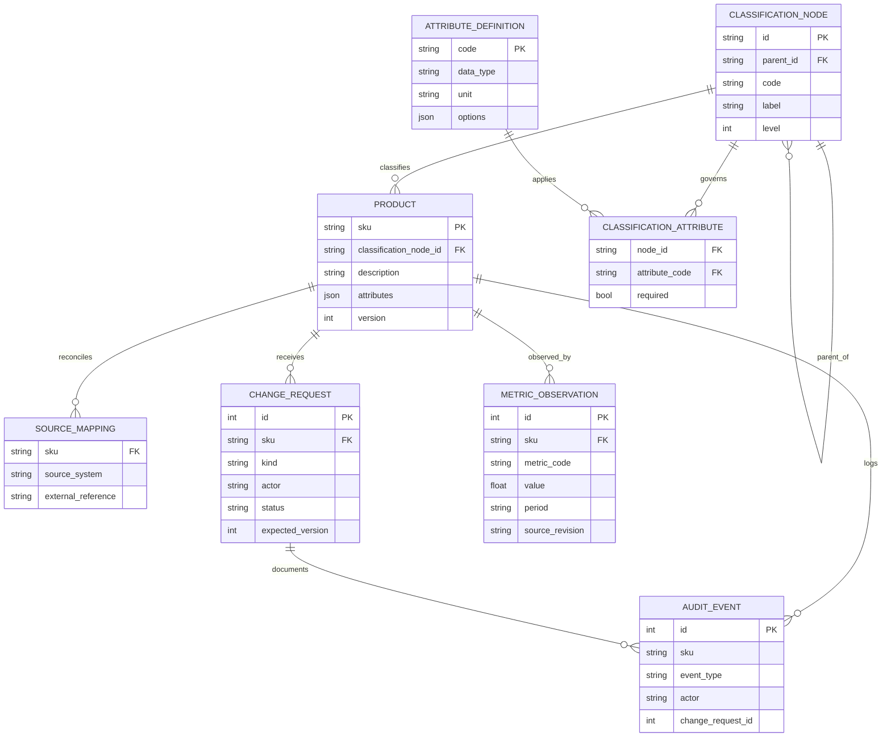

# Logical data model

The portfolio implementation is intentionally **relational and metadata-driven**. Sales, demand, stock and finance observations have separate authority from product master fields.

**Data ownership:** the product record owns governed identity, classification and technical values; external observations are never editable through the product field API. The most-specific node determines path ancestry and inherited attributes.

**Physical demo:** SQLite stores `attributes` as validated JSON strings; a protected enterprise deployment could use a relational/JSONB implementation and migration framework, keeping the public contract stable.
